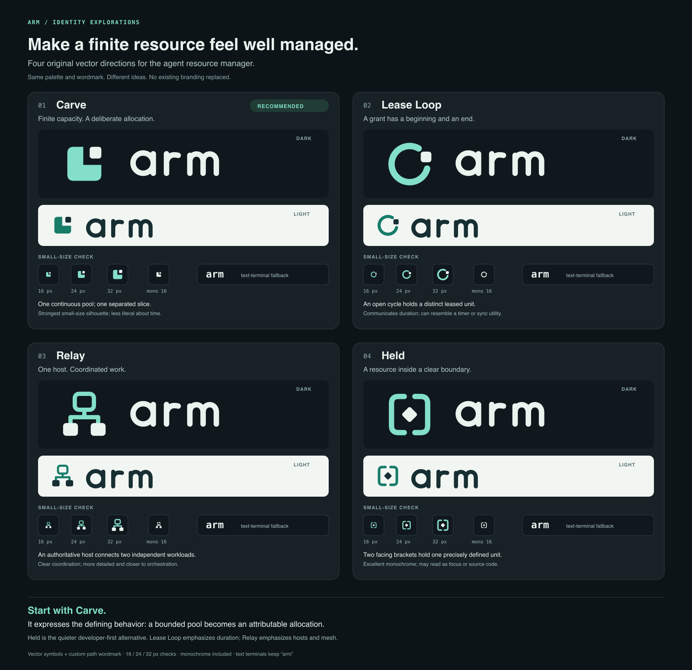

# ARM identity explorations

These are four proposals for review. None replaces the dashboard, CLI or terminal branding.



**Recommendation: Carve.** ARM's defining idea is a finite resource pool with attributable allocations. Carve expresses that with one continuous shape and one separated unit. It has the strongest silhouette at small sizes and works without color. Held is the quieter alternative if a more explicitly developer-oriented identity is preferred.

| Direction | Idea | Strength | Tradeoff | Files |
| --- | --- | --- | --- | --- |
| **Carve** | A leased slice of a finite pool | Simple, recognizable silhouette; directly about allocation | Time and multi-host coordination are implicit | [Preview](carve/preview.png), [dark SVG](carve/lockup-dark.svg), [light SVG](carve/lockup-light.svg) |
| **Lease Loop** | A distinct unit held within a cycle | Suggests a grant, release and return | Can resemble a timer or synchronization utility | [Preview](lease-loop/preview.png), [dark SVG](lease-loop/lockup-dark.svg), [light SVG](lease-loop/lockup-light.svg) |
| **Relay** | One authoritative host coordinates independent workloads | Makes the host and future mesh story visible | More detailed at 16 px; closer to an orchestration product | [Preview](relay/preview.png), [dark SVG](relay/lockup-dark.svg), [light SVG](relay/lockup-light.svg) |
| **Held** | A clearly bounded and accountable claim | Calm, strong monochrome form; familiar to developers | Brackets can suggest source code or focus tools | [Preview](held/preview.png), [dark SVG](held/lockup-dark.svg), [light SVG](held/lockup-light.svg) |

The comparison uses one palette and wordmark so the underlying ideas can be judged fairly. The lowercase `arm` wordmark is drawn with original geometric SVG paths; no font is embedded or required for the standalone marks. Explanatory text on the comparison board uses ordinary system font fallbacks. Shape studies are original project work, with no third-party image assets.

Each direction includes:

- Transparent `symbol-dark.svg`, `symbol-light.svg` and black `symbol-mono.svg` at a 96-unit viewBox.
- Transparent dark/light `lockup-*.svg` at 360 × 96, with PNG previews flattened onto matching backgrounds.
- A standalone `preview.svg` / `preview.png` and dark/light favicon previews at 16, 24 and 32 px.

The board shows actual-size small symbols and a 16 px monochrome check. The terminal fallback stays the literal text `arm`; these proposals do not depend on a special Unicode glyph, terminal image protocol or patched font. The black monochrome SVG can be recolored at integration time, or used on a light background. Dark and light variants are designed for their corresponding backgrounds.

## Reproduce

```sh
python3 docs/branding/generate.py
# Optional PNG rendering, if Sharp is already installed:
node docs/branding/render.cjs
# Or supply an existing Sharp module path; no project dependency is added:
node docs/branding/render.cjs /absolute/path/to/sharp
```

SVG generation uses only Python's standard library and is deterministic. PNG rendering is offline with Sharp; system fonts can change the explanatory text rasterization. Symbol and wordmark geometry is font independent. Preview PNGs are review artifacts, not an installed favicon or terminal logo. Before adopting one direction, refine optical alignment at the chosen final sizes and test it in the actual product surfaces.
