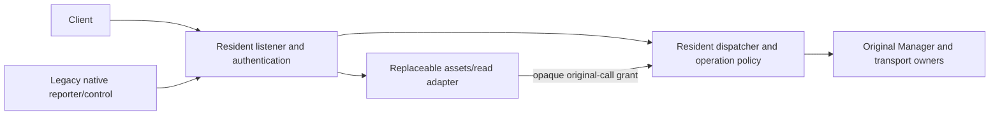

# Resident authentication and dispatcher contract

Status: source-backed interface proposal only. Baseline:
`f150f6bfc8693cdfb8a91d2cd9ab98558357a93f`, which accepts the private prototype
and its alias correction. This document changes no product/private code, wire
schema, defaults or running state. The [accepted proof](../validation/resident-worker-composed-2026-10-29.json)
does not establish production authentication, proxy or provider continuity.

## Proposed boundary

Keep the existing local listener, authenticated connections and dispatch authority
resident. Introduce an explicit resident-owned authenticated caller before
extracting handlers. Worker identity authenticates a replaceable adapter; it
never authenticates an external client or supplies native/browser/peer flags.

The smallest shared edit is an in-process extraction with the existing wire
surface and behavior. It does not launch workers or turn on production IPC.
Then serve reviewed worker assets behind the resident origin and add a small
read-only worker path. Mutations, native reporting, administrative workflows and
job-bearing streams continue through resident handlers until individually gated.
Replacing API presentation code does not imply that the Manager or all of
`Server` becomes replaceable.



## Current trust boundaries to preserve

| Path | Actual source behavior | Extraction consequence |
| --- | --- | --- |
| Local native CLI | `client.Connect` reads the private endpoint and sends its bearer. `Server.ws` checks Host and `authenticateAdmission` compares against the current resident token. This is credential possession under the state-owner account, not native-process attestation. | Never inject the master bearer into a worker's public request to simulate a native caller. |
| Browser | Authentication requires the expected Origin, `arm.v1`, one `arm.auth.*` token and an unexpired resident session entry. Local and node-session maps cannot both classify the same credential. | Resident session lookup determines browser restrictions; a missing worker flag cannot mean native. |
| Browser ticket exchange | One-use short-lived ticket, bounded session maps, exact Host/Origin/content type and optional exact host/window nonce; node tickets retain parent expiry/binding. | Keep exchange and credential tables resident. Worker HTML receives no server-side master credential. |
| Native selected node | `Arm-Node-Context: v1` requires the exact first `node_context_open` frame before ordinary dispatch; browser callers cannot use that native negotiation. | A negotiating caller has no ordinary dispatch authority. Failure closes that connection, without fallback. |
| Selected local node | Presence of a node binding forbids `dashboard_login_link`; otherwise local dispatch retains native or browser restrictions. | Do not collapse a selected-local caller into an unrestricted ordinary caller. |
| Selected remote node | `nodeSessionOperation` is a closed read-only gateway. Each call checks source/host, current pair/certificate/local revision, destination access scope/remote revision and target response. | Never turn a remote node into local/native access when a worker or peer is unavailable. |
| Peer presence | `/v1/peers` requires the exact loopback GET path without query, Origin, Authorization or Cookie headers. It uses its own signed nonce/directory-record exchange, enabled-publication checks, slots and three-second context. | Keep this separate presence protocol resident; browser/session or mesh authentication is not a substitute. |
| Direct mesh | Separate TLS listener and closed RPC surface. `/v1/mesh` requires a peer certificate and absent Origin; `PeerByCert` and `WithPeer`/`WithPeerSnapshot` establish current grants. Destination and expected enrollment are checked separately. | Do not mint a mesh principal from local JSON or reuse the local dispatcher for peer RPC. |

Source anchors: [native client](../../internal/client/client.go#L16),
[local WS admission](../../internal/server/server.go#L376),
[Host/authentication](../../internal/server/browser.go#L78),
[ticket exchange](../../internal/server/browser.go#L293),
[node ticket/credential state](../../internal/server/node_sessions.go#L43),
[native node negotiation](../../internal/server/native_node_context.go#L20),
[node revalidation](../../internal/server/node_sessions.go#L120),
[remote node gateway](../../internal/server/node_gateway.go#L15),
[peer presence exchange](../../internal/server/presence.go#L180),
[mesh admission](../../internal/server/mesh.go#L204).

`authenticateAdmission` currently tests native bearer authentication before its
browser-Origin branch. Preserve that distinction and the existing WebSocket
accept/origin behavior; do not replace it with a permissive reverse proxy.
The loopback listener and exact public Host are part of this boundary. Workers
are trusted same-account code, not an OS sandbox against the state owner.

## Proposed interfaces and modules

The following names/signatures are proposals, not existing APIs. All constructors
and fields below remain private to `internal/server`. They are not JSON DTOs.

```go
// internal/server/resident_auth.go
type authenticatedCaller struct {
    owner      *Server
    ingress    *residentIngress       // original resident-owned connection
    proof      *ingressProof          // resident registry entry; never serialized
    state      callerState            // zero/unbound/negotiating cannot dispatch
    generation string                // actual resident lifetime
    admission  browserAdmission      // minted only after original credential checks
    node       *nodeSession          // immutable negotiated binding, when present
}

func (s *Server) authenticateLocalIngress(
    r *http.Request, now time.Time,
) (*authenticatedCaller, error)

func (s *Server) negotiateCallerNode(
    ctx context.Context, caller *authenticatedCaller, c *websocket.Conn,
) (*authenticatedCaller, model.NodeContextReport, error)

// internal/server/resident_dispatch.go
type preparedCall struct {
    owner      *Server
    caller     *authenticatedCaller
    request    model.WireRequest      // owned copy, including exact Params bytes
    paramsHash [32]byte
    policy     operationPolicy        // resident catalog, never worker-selected
}

type dispatchResult struct {
    wire       json.RawMessage        // owned final WireResponse bytes
    effect     effectDisposition      // resident/domain evidence, not worker success
    recovery   *recoverySelector      // existing exact operation/lease binding
}

func (s *Server) prepareCall(
    caller *authenticatedCaller, request model.WireRequest,
) (*preparedCall, error)

func (s *Server) dispatchPrepared(
    requestCtx context.Context, call *preparedCall,
) dispatchResult
```

`residentIngress` is registered only by the owned listener after current
authentication, and is invalidated when that connection ends. Caller validation
checks registry membership, exact `Server`/resident generation, resident directory
identity, credential/session expiry and the original node binding. A forged,
zero, foreign-server, negotiating or retired caller is denied. The resident may
retain a session fingerprint and original admission proof; raw bearer/session
credentials never go to workers. Browser and node context values used by legacy
handlers are restored only from this verified object inside `server`.

`prepareCall` freezes intent and selects policy; it performs no resource admission
or native effect. Node/grant and lifecycle checks that can query authoritative
state happen again in `dispatchPrepared`, under the existing ordering. Its outer
wrapper registers the operation exactly once with `registerStopOperation`,
revalidates the caller, and calls an extracted resident operation body. Avoid
double registration by retaining the current outer wrapper until that extraction
is reviewed. Existing per-provider/transport registrations remain intact.

The current `dispatch(ctx, request)` relies on context values to apply browser
restrictions and selected-node routing. Only `ws` calls that local production
entry; mesh has a different `meshService.dispatch`. The proposed extraction must
remove the possibility that absent context values on a new entry imply native
authority. Tests that call the old private dispatcher need explicit resident
authentication fixtures, not an exported constructor accepting role flags.

For a later worker bridge, use a new production transport module such as
`internal/residentipc`; keep the accepted prototype's `local-fixture` principal
unchanged. Proposed wire DTO and resident entry points:

```go
// internal/residentipc — bounded transport DTOs only
type Execute struct {
    Protocol    uint16 `json:"protocol"`
    WorkerEpoch string `json:"worker_epoch"`
    RequestID   string `json:"request_id"`
    GrantRef    string `json:"grant_ref"`
}

// internal/server/resident_worker_bridge.go
func (s *Server) grantWorkerCall(
    worker *verifiedWorker, call *preparedCall,
) (residentipc.Execute, error)

func (s *Server) executeWorkerCall(
    ioCtx context.Context, worker *verifiedWorker, message residentipc.Execute,
) dispatchResult
```

`verifiedWorker` comes only from the separately reviewed original worker/channel
controller. Its identity is checked against the actual inherited channel; the
wire epoch is only a required consistency check. `GrantRef` is an opaque random
resident registry handle, distinct from the durable domain operation key.
Its record binds the original caller/ingress, resident identity, worker epoch,
request ID, operation, raw-params hash, policy, expiry and any exact operation key,
target or reviewed revision. A worker cannot supply replacement params, role,
host, owner, certificate, grant revision or operation through `Execute`.
The private `RequestID` is a bounded resident-generated correlation ID, not an
unbounded copy of the public request ID; the original public ID stays in the
resident call and its response.

Execution resolves the original resident-owned call and registers it exactly
once against the active epoch under the same serialized cut used by sealing.
It revalidates current authorization in the resident. `ioCtx` bounds transport
delivery only; the registry supplies the original request context and the domain
handler retains its existing admission/lifetime rules. Sealing rejects new
old-epoch work; already-admitted work retains its domain owner. The controller
must separately join admitted dispatch and the original native worker/I/O before
activating its successor, as specified below. Bounded grant expiry/refusal before
invocation is distinct from unknown effect after invocation. Response lookup
belongs to the resident ingress/domain
and must not execute the call again. This design initially forwards an unchanged
existing operation; composite reads or new write workflows need separate grants
and review rather than an ambient native capability.

Grant records distinguish prepared, dispatched, completed and positively refused
before-dispatch states. A duplicate `Execute` never registers another invocation;
it can only join/inspect the original resident result under the same binding.
Expiry/sealing can refuse prepared grants, but cannot reclassify dispatched work
as unexecuted. Retire result records only after delivery/handling is positively
settled or the domain's reviewed recovery contract retains the obligation.

Proposed initial bridge bounds are 4 KiB for private control frames, 32 live grant
records total (including undelivered completed results), four per ingress and
eight executing reads total. Pending/unknown records remain counted. Retained response
bytes are bounded globally, with a 4 MiB per-response ceiling consistent with
current native client read limits; eight full responses already require 32 MiB
before copies/metadata. Charge actual configured buffers/overlap before enabling
the bridge. Do not copy the fixture's 256 KiB reply ceiling into production and
silently truncate existing data. Raw authoritative bytes must not acquire an
unaccounted base64 expansion. Deadline is no later than the original credential/
ingress request limit, with a proposed fifteen-second ceiling for optional
browser-read grants. Overflow/expiry refuses a not-yet-dispatched grant rather
than evicting pending or uncertain outcomes. Native reporting/control capacity
is independent of these worker-read slots.

For public v1, the original resident ingress writes the resident-owned response;
a worker completion message is not that response's authority. Return only a
bounded completion/reference acknowledgment over the worker-control path where
possible. New URL schemas, composite queries or worker-transformed API response
contracts require an explicit extension. The first externally useful reload is
coherent asset/UI replacement; dispatcher extraction alone does not establish
hot replacement of all server-side API handlers.

Private DTOs require canonical typed field names and bounded framing, as in the
accepted alias fix. This is not a proposal to change every public v1 payload
parser during extraction. Existing operation validators determine actual typed
keys/commitments; preserve exact input bytes and existing accepted semantics.
Never derive authority or a key using a second, inconsistent parse of the body.

## Operation and lifetime catalog

`internal/server/resident_operations.go` should define a closed catalog containing
route (`direct`, `worker-read`), allowed verified caller class, lifetime, result
bound and domain recovery policy. Any unclassified operation stays on its existing
resident path; it is forbidden through the worker bridge. The first worker subset
is local-browser `status`, `resources`, `inspect`, `runs`, `run_inspect`,
`run_output` and `events`, each still authorized by existing resident handlers.
This adds no permission for remote node windows or direct peers.

Proposed file/call-site ownership for central review:

| Module | Minimal affected entry points |
| --- | --- |
| `server/resident_auth.go` | Wrap `browser.go` Host/auth/session lookup and `native_node_context.go` first-frame completion into private verified callers; retain actual credential maps and node guards. |
| `server/resident_dispatch.go`, `resident_operations.go`, `resident_outcomes.go` | Extract `server.go:dispatch` outer guard/body/projection into prepared-call execution; default worker-deny for unclassified operations. |
| `server/server.go:ws` | Obtain a verified caller; keep validation on special subscriptions as well as ordinary calls; use original ingress contexts and resident response writer. |
| `server/resident_worker_bridge.go`, new `residentipc` package | Resolve bounded opaque original-call grants on an authenticated original worker channel; do not widen `resident.Principal`. |
| `server/resident_assets.go` | Later manifest-only asset route behind existing resident Host/CSP/origin checks; no auth/session or transport migration. |
| Existing `client/*`, `cli/runs.go`, `cli/mesh.go` | No initial wire/endpoint/reporting change. Compatibility targets, not extraction edits. |
| Existing Manager/provider/mesh/SSH modules | No initial ownership, persistence or policy edit. Their existing domain APIs remain resident. |

| Family | Proposed initial route / lifetime |
| --- | --- |
| Native CLI/TUI calls, including `acquire`, `run`, renewal/end, `output`, `inspect` | Direct resident. Preserve existing validation, fairness and original Manager owners. |
| `run_create`, `run_append`, `run_finish`, log inspection | Direct resident, including legacy proxy reporting; no worker hop or worker-availability dependency. |
| Selected-node negotiation and operations | Direct resident; immutable source/destination scope and pre/post-read grant validation remain closed. |
| Browser snapshot subset above | Eligible for later one-call read grant; request/credential bounded. Authoritative data acquisition remains resident initially. |
| Other reads, naming and diagnostics | Resident until explicitly classified. A read-like name is not proof of no effects, credential access or native ownership. |
| `subscribe`, monitor subscribe/unsubscribe, `mesh_operator_watch`, peer presence | Resident subscriptions with their existing per-connection contexts, slots, epochs/cursors and joins. |
| Browser `lease_action`, pool mutations, names, owner availability, messaging/reviews | Direct resident with current browser allowlists, exact revisions/consumer reviews/keys and per-family rules. No blanket write grant. |
| Mesh setup/dispatch, operator workflows, contacts/publications, workspace operations | Resident. Preserve current closed grants, explicit reviews, native constructors and durable workflow owners. |
| SSH, routed SSH, forwarding, workspace/sync, screen transports | Original resident transport owners. Keep job-bearing connections alive across worker changes; do not proxy them through the replaceable worker. |
| Storage preparation/export/cleanup, Cargo/Gradle/provider work, Kubernetes inventory | Resident, with existing original handles and credential/cleanup policy. Kubernetes discovery is not resource admission and is not necessarily a pure cached read. |
| Runtime proof, database operations, stop/restart/reset/uninstall | Resident administration with original exact authority/generation and desired-state gates. |

The WS reader handles subscriptions and workflow watches before ordinary
`dispatch`; it also checks node context before those branches. Consequently a
dispatcher-only guard is insufficient. The same authenticated caller/policy
classification must govern those branches, retaining remote-node exclusions.
Keep resident response projection (`namedView`, `customNamedView`, source-named
reads, bounded pool encoding and naming diagnostics) with dispatch initially.
Only copied authoritative bytes may cross a worker boundary. View code must not
forge successful effects, normalize identifiers, lose number precision or share
cached snapshots across distinct principals/selected destinations.

Source anchors: [dispatch guards](../../internal/server/server.go#L764),
[special subscriptions](../../internal/server/server.go#L519),
[response projection](../../internal/server/server.go#L732),
[browser lease action](../../internal/server/server.go#L880),
[revision/consumer validation](../../internal/manager/operator.go#L5),
[mesh destination grants](../../internal/server/mesh.go#L370),
[SSH scope and original transport](../../internal/server/mesh_ssh.go#L101),
[workspace transport](../../internal/server/workspace_transport.go#L68),
[screen request lifetime](../../internal/server/screen.go#L244),
[Kubernetes inventory](../../internal/server/kubernetes_inventory.go#L38).

### Contexts must follow the existing owner

Use three explicit lifetime classes; do not replace all handler contexts with
`Background`, and do not use a worker-channel context as the resident job parent.

- **Request/subscription bound:** reads, preflight and view subscriptions retain
  the original resident ingress deadline, caller expiry/revocation and normal
  cancellation. Worker IPC cancellation may end its delivery/view only.
- **Resident after domain admission:** generic run's original waiter and Cargo
  already have independent lifetimes. Storage export persists its plan before
  creating a bounded independent worker; operator workflows derive from the
  resident service context. Preserve their actual admission cuts and original
  cancellation registries; do not move them into the API worker.
- **Transport owned:** SSH/sync/forwarding and screen duties retain their original
  connection/I/O joins and entitlement. Some transport loss intentionally cancels
  execution today. Preserve that rule while keeping the original transport
  resident across a worker change; detaching it would be a semantic change.

See [generic waiter](../../internal/manager/manager.go#L2261),
[Cargo lifetime](../../internal/manager/cargo_launch.go#L85),
[export admission/lifetime](../../internal/manager/storage_export.go#L296),
[operator service parent](../../internal/server/mesh_operator.go#L62),
[operator workflow start](../../internal/meshops/service.go#L281), and
[transport settlement rationale](../original-child-supervision.md).

## Legacy reporter and origin compatibility

Keep `endpoint.json` pointing at the resident-owned literal-loopback listener and
`/v1/ws`. Its bearer, PID, host/owner/directory binding and backend generation
remain resident facts across worker swaps. `client.Connect`, ordinary native
calls, `Follow` and TUI sessions continue to reach that listener directly.
Never repoint the endpoint file at the worker's fixture/private port or rename
worker epochs into backend generations.

`runReport` rereads that endpoint and bounds each append/finish call to five
seconds. A proxy emits a five-second empty heartbeat, and any reporting error
cancels its original child context. `Manager.initRunRecords` would invalidate
active reporters on core restart. Therefore compatible worker replacement must
keep the native listener, Manager and reporter state continuously alive. The
resident reporter/control route needs independent bounded capacity so worker
backpressure cannot consume its service path. Do not turn a browser request
named `run_append` into native access: original authentication still decides.
Current `stopInspection` permits append/finish during ordinary drain; a worker
seal must not set `stopping`, invoke shutdown drain or refuse ordinary renewals.

Source anchors: [endpoint publication](../../internal/server/server.go#L336),
[CLI native call](../../internal/cli/cli.go#L173),
[reporting/error cancellation](../../internal/cli/runs.go#L104),
[proxy child owner](../../internal/cli/runs.go#L274),
[reporter startup invalidation](../../internal/manager/runs.go#L42),
[stop operation classification](../../internal/server/node_stop.go#L49).

Use the existing resident listener as the stable browser origin as well. Keep
`/v1/browser/session`, `/v1/ws`, `/v1/screen` and `/v1/peers` resident. A proposed
`resident_assets.go` may fetch only manifest-approved asset paths/bytes from the
active worker, never arbitrary URLs, credential-bearing requests or forwarded
authority headers. The resident retains exact Host/Origin validation, no-store,
CSP and browser-session response construction. Do not rewrite the client Origin
to a worker-private address or inject a native bearer into browser requests.

The worker may own HTML/JS/CSS/WASM and pure rendering adapters. A versioned asset
manifest must prevent an old HTML document from mixing incompatible new JS/WASM
after a swap; use reviewed build-pinned asset URLs/retention, not an unchecked
latest-file lookup. Retained pinned bytes must remain available from reviewed
immutable storage without keeping a retired worker alive. A page already loaded
continues using its original code until an explicit reload; no in-page module
or application-state migration is proposed. That is a separate frontend/controller
integration gate.
With the same resident token/session maps and public origin, browser reconnect
can reauthenticate to the resident and load fresh snapshots/cursors. Worker
changes grant no extra session lifetime. Resident restart remains a new backend
generation and may require a fresh dashboard link. Native node sessions never
silently retarget, and remote windows retain their narrow scope.

## Domain keys and caller-visible uncertainty

| Operation family | Current commitment/recovery semantics that must remain authoritative |
| --- | --- |
| Local acquire/run | Saved request key plus normalized request and saved command/CWD/SSH commitment. Duplicate key does not authorize another launch. Source constructors have stricter no-adoption rules. |
| Legacy proxy | Create key; append exact offset/size/hash receipt and accepted/retained byte counters; finish exact terminal outcome. No new launch/reporting retry contract is implied. |
| Local plain renew/end | No general operation-key receipt. Never automatically replay after lost delivery: renewal can extend entitlement again. Inspect exact lease/revision and preserve uncertainty. |
| Browser lease action | Reviewed lease revision and attached-consumer revisions; current behavior has no generic operation key. Revision conflict is not permission to fetch a new revision and repeat automatically. |
| Pool/name/availability/bulk/message/export/review workflows | Existing family keys, reviewed revisions, target/consumer scopes and durable outcomes. Inventory each handler before worker writes are allowed. |
| Remote mutation | Preserve destination, original key and authenticated peer/certificate/revision. `PeerOnceAuthenticated` retains pending/unknown; destination authority owns expiry and settlement. |
| SSH/sync/workspace/operator | Retain their original control commitments, operation journals and explicit lookup/reconcile/handoff protocols; do not collapse them into generic success/failure. |

Source anchors: [acquire replay](../../internal/manager/manager.go#L962),
[proxy append](../../internal/manager/runs.go#L437),
[proxy finish](../../internal/manager/runs.go#L543),
[plain renewal](../../internal/manager/manager.go#L1662),
[revision action](../../internal/model/operator.go#L8),
[bulk captured scope](../../internal/manager/bulk.go#L23),
[peer-once](../../internal/manager/mesh.go#L62),
[CLI remote unknown outcome](../../internal/cli/mesh.go#L22).

Proposed `resident_outcomes.go` should return an owned final response plus a
resident-only disposition: `not_dispatched` (positive pre-effect refusal),
`domain_result` (typed result/error with that family's actual meaning), or
`effect_unknown` (no sufficient acknowledgment). Request ID, caller/call grant,
durable domain key and worker epoch remain different identities. Preserve
`model.Error` codes, named-view diagnostics and exact recovery selectors; an
error is not universally proof of no effect, and a returned lease is not proof
of terminal cleanup. The public v1 response remains unchanged in the first
extraction. Additional wire-visible delivery metadata needs explicit versioning.

Worker/channel loss does not cancel admitted resident work. The resident retains
or delivers its authoritative result to the original ingress when possible.
If delivery is lost, disclose uncertainty and use the existing family lookup or
lease inspection; never generate a fresh key, retarget a peer, retry unkeyed
renewal or convert a private-channel timeout into resource release. Do not wrap
all production operations in the fixture's separate generic receipt journal:
native callers bypass it, and it is not atomic with domain effects. A production
receipt extension is a separate per-family storage/version review.

## Stop ordering, artifacts and separately gated work

### Replacement ordering required of a future controller

This refines the selected [replacement lifecycle](resident-supervision.md#worker-replacement-lifecycle).
It proposes no new controller implementation or production activation here.

| Transition | Required condition and authority |
| --- | --- |
| `staged` → `launch_pending` | Persist the exact replacement key, resident generation, prior revision, old/candidate epochs, reviewed artifact identity and required protocol/features before spawning. Admit overlap, buffers, storage and retained cleanup obligations. |
| `launch_pending` → `ready` | Retain the original process owner, wait/I/O handles and authenticated inherited channel. Verify handshake/build/protocol against the recorded candidate. A ready candidate has no dispatch grants or public traffic. |
| `ready` → `sealing` | Under the resident lifecycle/epoch cut, reject activation if stop intent won. Seal old-epoch admission and invalidate its still-unexecuted grants. Do not cancel admitted operations or set the node's shutdown/draining state. |
| `sealing` → `old_join_pending` | Positively join all admitted dispatch, or record each domain's already-supported durable asynchronous handoff. A returned job ID does not mean the job has ended: its original resident owner continues. A timeout or broken pipe does not supply a dispatch join. |
| `old_join_pending` → activation eligible | Stop only the original old worker and its worker-owned ingress; positively observe its original native Wait/owned-group cleanup and all worker-owned I/O joins. The shared resident listener and original client/job transports stay resident. Close/fence the old private channel and capability. Preserve failed/unknown owners and their charges; do not claim this condition from epoch sealing alone. |
| activation eligible → `active` | Recheck stop intent and the exact prior controller revision, durably commit one new active epoch, then route new worker traffic to it. Candidate readiness alone cannot publish authority. An uncertain activation acknowledgment requires same-key lookup, not another spawn or guessed epoch. |

Candidate staging, process startup and handshake may overlap the old worker.
The first contract permits no overlap of public worker serving or resident
dispatch authority. Even bounded read-only serving by two generations would
need an explicit later policy, accounting and version-pair review. The resident
listener, native control/reporting and job-bearing transports remain available;
optional worker reads/assets may briefly refuse or reconnect during the cut.
An asset manifest check cannot use a candidate's inactive capability to perform
resident operations as a readiness probe.

The private `Authority.Activate` checks old-epoch sealing and admitted-dispatch
join; it does not check native worker exit. The fixture launcher separately
observes original native and transport joins. A production controller must
compose both conditions rather than treating either as the other. See
[authority admission/activation](../../internal/resident/authority.go#L113) and
[fixture retirement](../../internal/resident/native_test.go#L192).

Before sealing, candidate failure leaves the old active worker usable. After
sealing, never unseal or resurrect the retired capability: rollback requires a
fresh epoch and the same reviewed transition, even for the old executable.
Unknown launch/activation outcomes retain their original key and selectors for
lookup; they do not authorize another spawn. Controller-journal failure blocks
new activation without blocking existing resident jobs or their settlement.

### Node stop and immutable artifacts

Preserve current `beginStopWork`/`registerStopOperation` ordering and the original
node-stop census, lifecycle/peer locks and desired state. Only pure unexecuted
worker grants may be revoked as pre-effect work. Already-dispatched operations,
resident job/transport owners and failed/unknown cleanup remain counted. An
operator stop blocks new worker activation under the resident lifecycle cut;
worker retirement cannot call `Manager.Close`, stop the gateway, close mesh or
write a stopped-node marker. Actual node stop still uses its normal original
joins and generation-bound completion. See [stop gate](../../internal/server/node_stop.go#L31)
and [shutdown worker](../../internal/server/shutdown.go#L32).

For future production bootstrap, run the resident from its own retained immutable
versioned executable path; stage each worker at a different retained path. A
generic digest-directory example is `artifact-<sha256>/arm`. The name/hash is
integrity evidence, not installation ownership, authenticated provenance or
permission to adopt an existing artifact. Existing managed installation receipts
and cleanup rules need their own reviewed local-installer integration.

`RuntimeExecutable.Proof` rechecks both startup inode and pathname, and Cargo's
helper source uses its `VerifiedPath`. Updating a mutable launcher/CLI path must
not replace the running resident's recorded pathname. Keep resident helper and
native `provision_runtime` proof tied to the old resident build; a new worker's
build cannot stand in for them. Retain old paths until original consumers stop.
Current `daemon start` launches `os.Executable` and returns if a backend already
runs; it does not establish immutable resident bootstrap. Initial adoption waits
for existing monolithic ownership to settle; do not re-exec/adopt it retroactively.

A future private worker role must require the original inherited channels and
explicit verified role/protocol before any ordinary CLI/default-home handling.
It must never fall back to `serve`, `daemon start` or plugin execution on mismatch.
Proposed installer/controller edits are not part of dispatcher extraction.
See [runtime proof](../../internal/mesh/runtime_identity.go#L32),
[helper binding](../../internal/server/server.go#L295),
[native-only runtime proof](../../internal/server/provision_runtime.go#L8),
[startup executable](../../internal/cli/cli.go#L964),
[existing early helper roles](../../internal/cli/cli.go#L56), and
[managed ownership registration](../../internal/mesh/install_ownership.go#L131).

Separate reviews are still required for candidate authentication/staging,
launch/replacement operation persistence and unknown-outcome recovery, original
worker process/transport cleanup, overlap/buffer/storage accounting, version and
feature negotiation, rollback, production routing, and resident-core/schema
upgrade. Report actual resident and worker build/protocol separately; never
advertise a new worker as upgraded resident capabilities. No source/version-pair
or production-controller acceptance follows from the same-binary fixture.

## Minimal central extraction stages and proposed tests

1. **Caller and dispatch extraction:** add the private server types/entry points
   above; adapt `ws` authentication, native-node completion, special subscriptions,
   ordinary dispatch and response projection. Existing listener, operations,
   contexts and clients remain resident. Keep peer dispatch and Manager/provider
   code unchanged. Review the entire direct and node/browser denial boundary.
2. **Read-only grant boundary:** add production DTOs/registry separately from the
   fixture principal; exercise the seven local-browser reads only, under exact
   caller/request/epoch binding. Native/proxy/remote-node/administrative paths
   bypass the worker. No production process activation in this stage.
3. **Assets and controller integration:** only after stage 2 review, propose
   immutable staging, native controller, stable resident origin, build-pinned
   assets and explicit version-pair tests. Preserve active native/proxy/transport
   paths while validating actual UI/API replacement.
4. **Further operations:** classify each mutation/workflow against its own domain
   receipt, authorization and lifetime before enabling it through a worker.
   Keep unclassified paths resident. Core/schema replacement remains separate.

| Proposed denial/lifecycle test | Required observation |
| --- | --- |
| Nil/zero/foreign/retired/negotiating caller; forged native/browser/owner flags | No dispatch/effect and no implicit native classification. |
| Missing/wrong native bearer; invalid Host; browser Origin/subprotocol/token ambiguity/expiry | Existing denial behavior, no native credential injection or permissive forwarding. |
| Node header on browser; wrong first frame/source; selected-local login link | Refuse before ordinary dispatch; no local fallback or context loss. |
| Remote node mutation/subscription/contact request; pair/cert/grant change during read | Closed remote allowlist and pre/post-validation; no local data or changed destination. |
| Local JSON claiming TLS peer/grant; peer revoked under admission | Separate authenticated mesh path and current locked grants remain required. |
| Stolen/reused/cross-caller/cross-worker grant; changed params/key/revision | Exact original registry/call binding; no replacement operation or effect. |
| Canonical private DTO and operation payload compatibility; typed aliases versus opaque keys | Private alias refusal remains; unchanged public inputs/domain parsers and case-sensitive data retain scoped behavior. |
| Worker seal/crash/slow reply with reads, a generic run and active legacy proxy | No Manager reopen/close, listener/token/generation change, proxy heartbeat loss or worker-parent cancellation of resident work. |
| Lost committed result across worker replacement; unkeyed renewal/lease-action conflict | Authoritative owned result or explicit unknown; no duplicate launch, TTL extension or automatic revised action. |
| Browser epoch change while native event/monitor/reporting and job streams remain active | Only intended worker view reconnects; native control/reporters and original job transports stay resident and joined. |
| Stop races with grant preparation/dispatch/activation and failed cleanup | Existing ordering, stopped intent and original census win; no timeout-derived join or erased charge. |
| New worker assets and old document; changed origin or credentials | Coherent pinned assets, resident CSP/session checks, fresh snapshots and immutable node scope. |
| New CLI/worker path while old resident launches helper/proves runtime | Original resident pathname/proof remains valid; no mutable overwrite or proof substitution. |
| Candidate/version mismatch or new worker requiring a missing resident primitive | Fail before sealing/activation; retain old supported service and original work. |
| Candidate ready while old dispatch is admitted; dispatch joined while original worker/I/O remains unjoined | Candidate stays inactive through both barriers; no effect authority or public serving overlap and no cleanup credit from timeout. |
| Lost launch/activation acknowledgment; rollback after sealing | Same-key lookup without duplicate spawn; a sealed capability never returns, including rollback to the same artifact. |

These are future test gates, not executed evidence. This proposal used read-only
source inspection plus document/link/diff checks only. It requires central
interface review before any shared source edit and no new runtime validation
window for the documentation itself.
