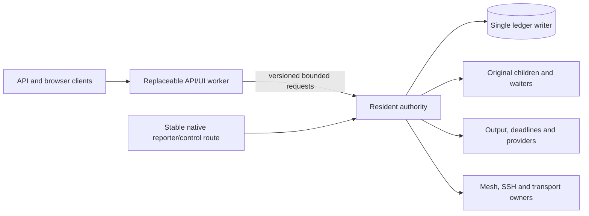

# Resident supervision and replaceable API/UI workers

Status: selected architectural direction with a
[private boundary and generic-job proof](../../internal/resident/README.md).
No production replacement controller or ordinary startup change is activated.
The source inventory in [the feasibility analysis](live-upgrade.md) is pinned to
`dfd916c`; the prototype uses reviewed base `80ca1ed`. Shared startup, CLI and
backend contracts remain unchanged and require a subsequent reviewed composition.

## Required behavior

An API/UI worker may change version while every admitted supported job keeps its
original native supervisor, output ownership, acknowledged entitlement and
resource obligations. A brief API disconnect/reconnect is acceptable. Worker
replacement must not call `Manager.Close`, restart/reopen the Manager, run startup
recovery, cancel a job because its requester disconnected, or create a second
writer. Ordinary lease expiry, explicit revocation and native failures still
apply. A worker outage does not pause entitlement or certify cleanup.

This changes the API/UI implementation while retaining resident custody code.
It does not claim that an arbitrary change to supervision, accounting, providers,
mesh enforcement or ledger semantics can take effect without replacing the
resident process. Resident-core upgrades remain a separate lifecycle operation.

Existing monolithic processes cannot transfer their original Go/native ownership
into this architecture retroactively. Initial adoption must wait for their work
to settle or use a separately reviewed ownership-transfer mechanism. Staging a
new executable never authorizes cancelling that work to bootstrap the design.

## Ownership boundary

The resident authority is a long-lived owner, not merely a parent that restarts
the current monolith. Initially retain `Server` components in the resident
process wherever they hold resource or transport duties. Extract only reviewed
presentation/transport adapters. A worker may render new UI and adapt a compatible
external API to the resident protocol. A new worker cannot activate resident
capabilities absent from that protocol.

| Responsibility | Required owner |
| --- | --- |
| `daemon.lock`, state-directory identity, ledger connection and startup recovery | Resident, once per resident lifetime |
| Admission, FIFO, budgets/pools, resource charges and live headroom observations | Resident |
| Original child handle, sole Wait, cancellation/escalation and sticky settlement failures | Resident, under the original job identity |
| Suspend-inclusive clocks, expiry, acknowledged renewal and cleanup | Resident, independent of worker availability |
| Logs, pipe copies, retained-byte counters and proxy reporting receipts | Resident or an explicitly retained reporter owner |
| Storage roots, port descriptors, Cargo/Gradle helper custody and original callbacks | Resident |
| Mesh/SSH/sync/forwarding/screen connection custody | Resident until each transport has a reviewed independent lifetime contract |
| Browser credentials, exact selected-node authority and operation authorization | Resident initially |
| HTTP request translation, compatible UI assets and view formatting | Replaceable worker |
| Worker process, its original Wait, epoch, capability and retained failed teardown | Resident worker controller |

Current source already provides useful lifetime separation for generic jobs:
[the original waiter](../../internal/manager/manager.go#L2261) uses its original
owner independently of the HTTP requester. Cargo also creates
[an independent worker lifetime](../../internal/manager/cargo_launch.go#L85).
These seams do not establish transferability of every request handler.
[Server dispatch](../../internal/server/server.go#L764) and
[browser/node authentication](../../internal/server/browser.go#L95) must retain
their existing checks when routed through a worker.

## Routes and authorization

Keep a stable direct resident route for current native proxy reporters. Their
[append/heartbeat failure behavior](../../internal/cli/runs.go#L119) cancels the
original child, so placing them behind a disappearing worker breaks the chosen
guarantee. The first worker proof must preserve the existing resident reporter
route rather than pretend reconnect alone fixes it. A future reporter-resume
protocol may migrate this route after client compatibility and bounded spool
semantics are proven. Do not redirect legacy reporters speculatively.

Initially keep native SSH/mesh and other job-bearing streams resident as well.
A browser disconnect may stop its observational viewer; it must not close the
resident transport that owns an active execution. Any path whose request context
currently owns an effect needs explicit classification before enabling worker
routing. Unknown coupling blocks that path's continuity claim, not its charges.

Use an inherited private channel/capability to identify a reviewed worker; never
send a master bearer in command arguments or publish the channel as a new public
service. Worker capability authenticates the adapter, not the external client.
The resident authenticates each client/session and reconstructs the exact
principal, browser restrictions, node binding, origin and grant checks. Wire data
such as `browser=false` or a selected host cannot manufacture native privilege.
No remote target receives a local credential. A worker running as the same OS
account is trusted code; this protocol is not an OS sandbox against that account.

Candidate staging must verify immutable bytes, ownership/mode, platform, build
identity, protocol compatibility and allowed features. Worker binaries must not
receive DB/authority-lock/provider/native-child descriptors or mutable resident
configuration. Retain old executable paths unchanged while helper/runtime proof
or rollback depends on them. Validate HTTP Host/Origin at the actual boundary;
never solve routing by disabling those checks or accepting arbitrary forwarded
identity headers.

## Private protocol and mutation boundary

Separate three identities: resident authority generation, worker generation and
durable operation key. Host, owner, original lease/run identities and resident
generation remain unchanged across a successful worker replacement. A worker
generation is never substituted for a workspace, membership, publication or
mesh enrollment generation.

Every accepted call carries protocol version, worker generation/capability,
exact resident identity, request ID, operation, bounded body and client principal.
Mutations also require the existing operation key/request commitment and revision
where supported. Request IDs correlate wire replies; they are not durable dedup
keys. Unsupported mutation replay is refused, not guessed. Keep the first proof
allowlist small: status, one generic run, keyed lookup, renewal, explicit end and
byte-offset log reads. No arbitrary method names or path-based authority.

Resident dispatch validates the worker epoch and registers each admitted call at
one serialized cut. Replacement first seals new calls from the old epoch and
waits for admitted dispatches to finish or reach an explicit durable asynchronous
handoff. It must not cancel their effects merely to finish switching. A job
launched by an admitted call becomes a resident lease, independent of that
worker's context. After the cut, stale requests cannot start new effects.

Lost IPC response after a committed operation remains unknown to the requester.
The new worker reads the original durable outcome with the same key and exact
binding. It never retries a mutation under a new key. `renew` currently lacks a
general worker-operation receipt: the proof must either add a reviewed durable
receipt at the resident boundary or exercise renewal through the stable native
route and state that limit. No reconnect-wide exactly-once claim follows from
the existing keyed acquire implementation.

Bound frame/body size, concurrent calls, pending response bytes, worker attempts,
outstanding teardown owners and operation history. Fix limits explicitly during
protocol review; do not silently evict pending/unknown receipts. A slow worker
must not hold Manager locks or consume expiry/finalization capacity indefinitely.

The control record must distinguish `staged`, `launch_pending`, `ready`,
`sealing`, `old_join_pending`, `active`, `failed` and `unknown` rather than using a
single running flag. Every transition checks the exact prior revision and
resident generation. The old active epoch stays authoritative until sealing;
the candidate is inactive until activation is durably acknowledged. Once an old
epoch is fenced, fallback requires a fresh epoch/capability, even when reusing
the old executable. Do not resurrect a retired capability after an uncertain
activation outcome.

Those are production-controller requirements. The private prototype persists
staged/active/sealed epoch markers and keyed dispatch receipts, retains two
original registrations, and refuses epoch continuation after restart. It does
not implement native launch/replacement-key recovery or certify process exit
from a registration/channel. Native launch/signal/Wait remain owned by the proof
fixture, and production activation remains disabled.

## Worker replacement lifecycle

1. Stage and verify the candidate without opening a second Manager or ledger.
   Reserve bounded overlap/diagnostic headroom under normal resource rules.
2. Persist the exact replacement key, candidate digest, old/target worker epochs,
   resident generation, protocol/features and revision before native launch.
   Record pending/unknown launch outcomes; retry by lookup, not another spawn.
3. Launch the candidate with its original process owner and inactive capability.
   Its handshake proves compatible build/protocol and resident binding, not
   admission authority. It must not accept public traffic yet.
4. Seal old-epoch dispatch. Preserve already-admitted resident operations and
   their outcome receipts. Resident expiry, renewal/control, reporters, mesh and
   job waiters keep running during this step.
5. Positively stop/join old worker ingress and worker-owned I/O; fence its
   capability before activating candidate traffic. Keep failed/missing join
   obligations. A timeout or closed control pipe alone cannot prove native exit.
   A shared listening descriptor is not permission for both workers to accept.
6. Commit the new active epoch and publish/route only to that worker. Public
   connection continuity is not required; stable address routing must be reviewed
   separately from authority publication. A worker-ready message alone does not
   establish actual public readiness.
7. Reconnect, authenticate, load fresh snapshots/log cursors and inspect original
   mutation outcomes. Do not replay pending mutation requests automatically.
   Retain activation results and retire only positively joined old workers.

The first proof may use explicit worker addresses to isolate lifetime behavior;
it cannot accept production endpoint/authenticated browser reconnection. A later
stable resident gateway or controlled listener handover must preserve the chosen
public origin while fencing actual acceptors. That gateway itself remains
resident and has a separately accounted lifecycle.

Worker replacement is distinct from node stop/reset/uninstall/core restart.
An operator stop intent fences replacement under the same resident lifecycle
authority. Failed replacement cannot resume a stopped node or weaken mesh grants.

## Failure and accounting contract

| Failure | Required behavior |
| --- | --- |
| Worker crashes, hangs or loses IPC | Resident jobs/reporters/clocks/cleanup continue; stale worker cannot issue new effects; API unavailable/reconnects visibly |
| Candidate launch/handshake fails before sealing | Keep old worker active; record exact outcome; no job cancellation |
| Switch ACK is lost | Same-key lookup returns current epoch/outcome; no duplicate process launch |
| Old worker refuses exit or join | Revoke dispatch authority; retain worker resources/cleanup debt; do not certify native exit from silence |
| Worker rollback | Activate only a protocol-compatible worker through a fresh reviewed transition; preserve ledger and resident identities |
| Journal/full-disk failure | Refuse new promises/effects where required; preserve bounded original cancellation/finalization and retained uncertainty |
| Resident crashes | Existing crash recovery rules apply; no claim that worker architecture preserves original supervision across resident failure |

Worker death never makes a lease terminal. Keep original CPU/memory/disk/pool/
budget promises charged once by their original identity. Include staging and
candidate/old-worker overlap, private-channel buffers and retained teardown in
control-plane accounting; do not borrow a job's resource grant. Fresh host
observations and conservative credit attribution remain mandatory. Resident
failure, ordinary entitlement expiry and a worker-only upgrade are separately
observable outcomes, not interchangeable reasons to reclaim resources.

## First bounded implementation proof and gates

The first delivered cut is an isolated resident/worker boundary with no ordinary
startup wiring. It uses one real Manager and one real generic job per native
case, synthetic private state, bounded original native processes, explicit helper
deadlines and retained output. The reviewed composition and allocated normal
resource window constrain the proof; they do not authorize production activation.
See [normalized evidence](../validation/resident-worker-prototype-2026-10-29.json).

| Gate | Required evidence |
| --- | --- |
| Original job spans two actual worker processes | Same resident PID/generation/Manager, lease/run ID and original child owner before/after; workload marker/output advances while worker is unavailable; no close/reopen/startup recovery |
| Explicit upgrade and worker-crash cuts | Replace a healthy worker and kill a worker during active work; distinguish them in outcomes; neither cancels resident work |
| Renewal and ordinary expiry | ACKed renewal controls the original deadline; expiry while workers are down reaches original cancellation/Wait; no free entitlement or false cleanup |
| Original completion and log continuity | Original sole Wait returns its exit status, log byte sequence is contiguous under retention rules, and terminal charge release follows positive settlement |
| Stale epoch/lost ACK/competing candidate | No stale effect, repeated native spawn or duplicate charge; original key resolves uncertain outcomes |
| Proxy/native control survives switch — open | Existing direct reporter path must remain available; a real proxy must continue output/finish. The generic-job proof does not establish this gate. |
| Native failure controls — partial | Journal fault/panic and malformed receipts are tested at the private boundary. Original job signal/Wait denial, PID reuse and all provider failure cases remain open. |
| No second writer | Worker never opens live ledger/authority lock or performs startup recovery; file/descriptor review and causal refusal controls demonstrate the boundary |

Focused normal/race and native Darwin proof cover the final private package.
Linux evidence is compile-only; native Linux execution remains open. Existing
passing cohorts cover their own source states; no failed attempt is relabeled.
Original native exit/cleanup and dispatch joins are observed directly. Product
activation, browser authentication, all other workload/transport classes, runtime
schema migration and resident-core replacement remain separate gates.

The first accepted proof is therefore evidence for generic resident-owned jobs
through worker replacement. Broader active-work coverage must be earned per
profile/transport without changing the requirement that existing admitted work
continues. Unimplemented paths stay on resident custody or remain disabled.
